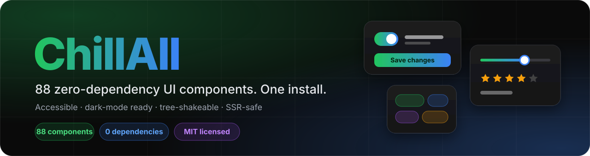

<div align="center">



<br>

[](LICENSE)
[](chillall/COMPONENTS.md)
[](#why-chillall)
[](#development)
[](#bundle-size)
[](#typescript)

**Alerts, modals, tables, charts, forms, pickers, navigation, overlays, data tools and runtime utilities.**<br>
Plain JavaScript. No framework, no dependencies, no CSS file to import.<br>
The same code runs in static HTML, React, Vue, Svelte and Next.js.

[Quick start](#quick-start) · [Components](#components) · [Theming](#theming-and-dark-mode) · [Frameworks](#use-it-with-your-framework) · [Development](#development) · [Catalog](chillall/COMPONENTS.md)

</div>

---

## Why ChillAll

- **One install, 88 components.** Everything from a button to a 100,000-row virtual list ships in a single package. No hunting for a date picker or a command palette.
- **Zero dependencies.** Not even a peer dependency on a framework. Each component injects its own CSS the first time you use it.
- **Tree-shakeable.** Import `ChillButton` and you ship about **4 KB gzipped**, not the whole library.
- **Accessible by default.** Correct roles and ARIA, full keyboard support, focus trapping and focus return, `prefers-reduced-motion`.
- **Dark mode that follows you.** The OS setting, or `<html data-theme="dark">`, or your own toggle. Every colour is a CSS variable.
- **Safe by default.** Text is rendered as text. HTML is always an explicit opt-in (`html: true`).
- **SSR-safe.** Importing the package never touches `window` or `document`, so Next.js and Nuxt just work.
- **Typed.** Generated TypeScript definitions are included.
- **Well tested.** 880+ automated tests cover behaviour, ARIA, cleanup and SSR loading.

## Quick start

### Install

```bash
npm install chillall
```

> **Note:** `chillall` is built from this repository. Until it is on the npm registry, build it from source (see [Development](#development)) and use `chillall/dist/`, or publish it from the `chillall/` folder with `npm publish`.

### Use it

```js
import { ChillAlert, ChillButton, ChillSlider } from 'chillall';

// 1. imperative helpers: dialogs, toasts, notifications
ChillAlert.toast({ title: 'Saved!', icon: 'success' });
const ok = await ChillAlert.confirm({ title: 'Delete project?', text: 'This cannot be undone.' });

// 2. create a component and put it on the page
const save = ChillButton.create({ text: 'Save changes', variant: 'primary' });
document.body.append(save);

// 3. mount into a container, listen for changes, clean up when done
const volume = ChillSlider.create({ value: 40, container: document.querySelector('#volume'), onChange: (v) => console.log(v) });
volume.destroy();
```

### No bundler? Use a script tag

```html
<script src="https://unpkg.com/chillall"></script>
<script>
  ChillNotify.show({ title: 'It works', message: 'No build step needed', type: 'success' });
  // every component is a global, and also lives on window.ChillAll
</script>
```

### The mental model

Every component follows the same three ideas:

1. **`create(options)`** builds new UI, **`init(target, options)`** enhances markup you already have.
2. **Options in, callbacks and events out:** `onChange`, `on('change', fn)` (which returns an unsubscribe function).
3. **Always clean up:** every instance has `destroy()` that removes DOM, listeners, observers and timers.

## Components

88 components in 7 categories. The full catalog with versions and public APIs is in [`chillall/COMPONENTS.md`](chillall/COMPONENTS.md).

| Category | | Components |
|---|---|---|
| **Core** | 7 | Alert, Form, Table, Chart, Date, Modal, Notify |
| **Form controls** | 17 | Button, Input, Textarea, Select, Dropdown, Checkbox, Radio, Switch, **Slider, Rating, OTP, ColorPicker, TimePicker, NumberInput, TagInput, Autocomplete, Segmented** |
| **Navigation** | 9 | Navbar, Sidebar, Footer, Breadcrumb, Tabs, Layout, **Stepper, ScrollSpy, Splitter** |
| **Feedback and overlays** | 18 | Tooltip, Popover, Accordion, Skeleton, EmptyState, Progress, Avatar, Badge, Tag, **Drawer, ContextMenu, Spinner, Callout, Lightbox, Tour, Copy, BackToTop, Confetti** |
| **Display** | 14 | **Card, Divider, Timeline, Tree, Carousel, Stat, Calendar, Code, Marquee, Countdown, Kbd, Masonry, Reveal, RelTime** |
| **Data** | 8 | Pagination, Search, Filter, Sort, InfiniteScroll, DragDrop, FileUpload, **VirtualList** |
| **Utilities** | 15 | Theme, Command, Hotkey, Provider, Config, Portal, FocusTrap, ClickOutside, MediaQuery, **Storage, Events, Fetch, Toolkit, Animate, Fullscreen** |

Components in **bold** are new in ChillAll 2.0.

Every component also lives in its own folder (`chillbutton/`, `chilltable/`, ...) as a standalone file you can copy into a project: `chill<name>/src/chill<name>.js`.

## Theming and dark mode

Every component reads the same contract: `<html data-theme="light|dark">` plus a `light` or `dark` class. `ChillTheme` manages it for you and persists the choice:

```js
ChillTheme.setTheme('dark');          // 'light' | 'dark' | 'system'
ChillTheme.toggle();
ChillTheme.onChange((resolved) => console.log(resolved));
```

Avoid a flash of the wrong theme on first paint: `ChillTheme.noFlashScript()` returns a tiny script (a string) that you inline in your page `<head>`, before your CSS. For example in a Next.js root layout:

```tsx
<head>
  <script dangerouslySetInnerHTML={{ __html: ChillTheme.noFlashScript({ defaultTheme: 'system' }) }} />
</head>
```

For static HTML, run `console.log(ChillTheme.noFlashScript({ tag: true }))` once and paste the output into your `<head>`.

Colours are CSS custom properties, so re-branding is a few lines:

```css
:root { --chillbutton-primary: #7c3aed; --chillbutton-primary-hover: #6d28d9; }
```

## Use it with your framework

The only integration rule: **create components in the browser** (an effect or an event handler) and **call `destroy()` on cleanup**.

<details>
<summary><b>React / Next.js</b></summary>

```tsx
'use client';
import { useEffect, useRef } from 'react';
import { ChillRating } from 'chillall';

export function Rating({ initial = 0 }: { initial?: number }) {
  const host = useRef<HTMLDivElement>(null);
  useEffect(() => {
    const rating = ChillRating.create({ value: initial, container: host.current! });
    return () => rating.destroy();
  }, [initial]);
  return <div ref={host} />;
}
```

Dialogs and toasts need no wrapper, call them from handlers: `onClick={() => ChillAlert.toast({ title: 'Saved' })}`.
</details>

<details>
<summary><b>Vue / Nuxt</b></summary>

```vue
<script setup lang="ts">
import { onBeforeUnmount, onMounted, ref } from 'vue';
import { ChillCalendar } from 'chillall';

const host = ref<HTMLElement | null>(null);
let calendar: any;
onMounted(() => { calendar = ChillCalendar.create({ mode: 'range', container: host.value! }); });
onBeforeUnmount(() => calendar?.destroy());
</script>

<template><div ref="host" /></template>
```
</details>

<details>
<summary><b>Plain HTML</b></summary>

```html
<button id="save">Save</button>
<script src="https://unpkg.com/chillall"></script>
<script>
  ChillButton.init('#save', { variant: 'primary', ripple: true });
</script>
```
</details>

## Bundle size

Measured on the ESM build with a production bundler (minified):

| You import | Minified | Gzipped |
|---|---|---|
| `ChillButton` only | 14 KB | 3.8 KB |
| `ChillAlert` only | 22 KB | 5.7 KB |
| `ChillButton` + `ChillModal` | 28 KB | 7.0 KB |
| Everything (default export) | about 1 MB | about 235 KB |

Run `node tools/treeshake.js` to reproduce these numbers.

## TypeScript

Type definitions are generated from the real sources (`chillall/dist/chillall.d.ts`), including the `window` globals for the CDN build. Public methods are declared on every component; option bags are typed loosely.

## Security

User-supplied strings in titles, labels, table cells, chart labels and icons are rendered with `textContent`. To render markup you must opt in explicitly (`html: true`, or an `*Html` option), and the places where markup is sanitised versus trusted are documented per component. CSV export guards against formula injection.

## Repository layout

```
chillall/              the single-file package (npm: chillall) and its generated catalog
chill<name>/           one folder per component: src/chill<name>.js (+ package.json)
src/, dist/            ChillAlert, the original package (npm: chillalert), with hand-written typings
tools/                 build, tests, docs generator, tree-shaking check, demo server
  build.js               bundles everything into chillall/dist (ESM, CJS, IIFE, min, d.ts)
  manifest.js            category map used by the bundle and the catalog
  tests/                 880+ behavioural tests (jsdom)
  CONVENTIONS.md         the rules every component follows
demo/                  the original ChillAlert demo page
docs/                  the original ChillAlert documentation
assets/                README artwork
```

Generated folders (`chillall/dist`, `chillall/src`, each component's `dist/`) are not committed; they are rebuilt by the tools below.

## Development

```bash
git clone https://github.com/steavengalang/ChillAll.git
cd ChillAll/tools
npm install                 # esbuild + jsdom (dev tooling only)

node build.js               # bundle -> ../chillall/dist (esm, cjs, iife, min, d.ts)
node sync.js                # copy each component's src/ into its dist/
node docs.js                # regenerate chillall/COMPONENTS.md
node treeshake.js           # verify tree-shaking and print bundle sizes
node smoke.js --all         # every component loads: SSR, CommonJS and <script>
node audit-theme.js         # every dark-mode media query respects an explicit light theme
node --test --test-force-exit tests/*.test.js

node serve.js               # live demo at http://localhost:5188/chillall/demo/  (run build.js first)
```

### Contributing a component

1. Create `chill<name>/src/chill<name>.js` following [`tools/CONVENTIONS.md`](tools/CONVENTIONS.md): SSR-safe, no XSS by default, dark mode via `data-theme`, accessible, with `destroy()`.
2. Add it to the right category in [`tools/manifest.js`](tools/manifest.js).
3. Add `tools/tests/chill<name>.test.js` and make `node smoke.js chill<name>` pass.
4. Run `node build.js` and `node docs.js`.

Pull requests are welcome.

## Upgrading from the separate packages (1.x)

`chillall` replaces the old per-component packages (`chillbutton`, `chilltable`, ...) and the meta-packages built on them. The behaviour changes worth knowing:

- **HTML is opt-in.** Strings are rendered as text unless you pass `html: true` (or the `*Html` option). `ChillModal` string `content` stays HTML for backward compatibility.
- `ChillHotkey`: registering the same shortcut twice keeps both handlers; plain-key shortcuts do not fire while typing in inputs unless `allowInInput: true`.
- `ChillCommand`: `mod+k` is Cmd on macOS and Ctrl elsewhere.
- `ChillAlert` 1.2 is SSR-safe and its dialogs trap focus and resolve on Esc.
- Stylesheets are injected at the start of `<head>`, so your own CSS overrides win.

The original ChillAlert documentation is kept in [`docs/chillalert.md`](docs/chillalert.md).

## License

[MIT](LICENSE) © 2025-2026 ChillCode Tech
